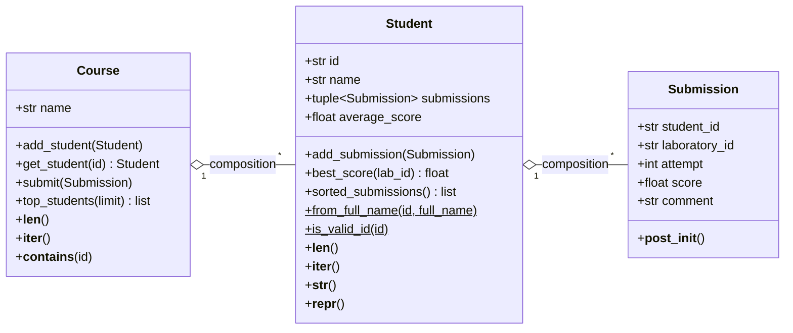
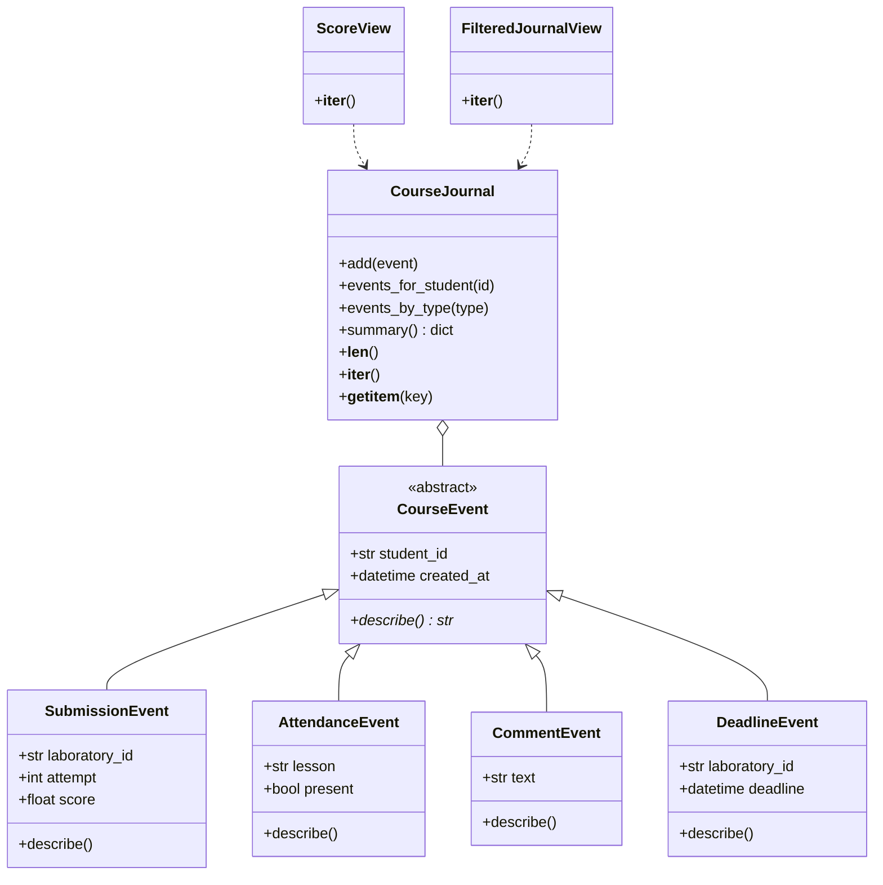

# Лабораторная работа № 4. Итераторы, генераторы и объектная модель Python

## 1. Задание 1. Протокол итерации

### 1.1. Что ожидалось увидеть

| Выражение | Ожидание |
|---|---|
| `iterator is values` | `False` — `iter()` для списка возвращает **новый** объект-итератор |
| `iter(iterator) is iterator` | `True` — итератор возвращает сам себя из `__iter__` |
| `next(iterator)` ×3 | `10`, `20`, `30` |
| 4-й `next(iterator)` | `StopIteration` |

### 1.2. Что увидели по итогу

Запуск `task_1.py` дал именно такие значения: первые три `next` вернули `10`, `20`, `30`, четвёртый — бросил `StopIteration`. При этом `iter(values)` каждый раз создаёт новый объект (проверено в расширенных сценариях), а уже полученный итератор при повторном `iter()` возвращает себя же (`id` совпадает).

После закомментирования последней строки файл завершается без ошибки — это требование выполнено.

### 1.3. Функция `consume()`

Реализована без `for`, без `list()` и без готовых накопителей: использует `iter()`, `next()` и обработку `StopIteration`. Проверена на:

* списке — `[1, 2, 3]`;
* кортеже — `(1, 2, 3)`;
* строке — `'abc'` → `['a', 'b', 'c']`;
* `range(5)` → `[0, 1, 2, 3, 4]`;
* частично исчерпанном итераторе: после одного `next()` остаётся `[2, 3, 4]`;
* повторный вызов на **том же** итераторе → `[]` (он исчерпан, `next` сразу бросает `StopIteration`).

**Ожидалось:** повторный обход списка даёт полный результат, повторный обход его итератора — пустой список.  
**Увидели:** так и есть. Причина — список является *iterable* (метод `__iter__` возвращает **новый** итератор), а сам итератор — *одноразовый* объект с состоянием, после исчерпания он больше не выдаёт элементов. Это и есть главное различие iterable vs iterator.

### 1.4. `my_enumerate()` и `my_zip()`

Обе функции реализованы как генераторы, работают с любыми iterable (список, кортеж, строка, `range`, генератор, `StepRange` из task_2). `my_zip` завершается, как только исчерпан более короткий источник. На `StepRange(2, 11, 3)`:

```text
list(my_enumerate(StepRange(2, 11, 3))) →
  [(0, 2), (1, 5), (2, 8)]

list(my_zip(StepRange(2, 11, 3), "abc")) →
  [(2, 'a'), (5, 'b'), (8, 'c')]
```

### 1.5. Ответы на вопросы

1. `iter(obj)` должен вернуть **объект-итератор** — то, у чего есть `__next__`. Для iterable-контейнеров это обычно новый объект.
2. `next(iterator)` после исчерпания обязан возбудить `StopIteration`, и все последующие вызовы тоже бросают `StopIteration` (а не возвращают значение).
3. Итератор возвращает себя из `__iter__`, чтобы соблюсти инвариант: «итератор сам является iterable». Это делает возможным `for x in it`, `list(it)`, `zip(it, ...)` — все эти конструкции начинают с `iter(obj)`, и если бы для итератора создавался ещё один итератор, состояние терялось бы, а протокол ломался (рекурсивное обёртывание).

---

## 2. Задание 2. Собственный итератор `StepRange`

### 2.1. Архитектура

* `StepRange` — *iterable*, хранит только `start`, `stop`, `step` (`__slots__`);
* `StepRangeIterator` — *iterator*, хранит `_current`, `_stop`, `_step`;
* `StepRange.__iter__()` создаёт **новый** `StepRangeIterator` — каждый обход независим;
* нулевой шаг отклоняется `ValueError`.

Внутренний `range` не используется, список значений не хранится.

### 2.2. Проверка граничных случаев

| Выражение | Ожидание | Получено |
|---|---|---|
| `list(StepRange(0, 5, 1))` | `[0,1,2,3,4]` | совпало |
| `list(StepRange(5, 0, -1))` | `[5,4,3,2,1]` | совпало |
| `list(StepRange(0, 0, 1))` | `[]` | совпало |
| `list(StepRange(0, 5, -1))` | `[]` | совпало (пусто, т.к. шаг положительный → диапазон некорректен) |

### 2.3. Схема состояния двух независимых итераторов

`StepRange(2, 11, 3)`, значения должны быть `2, 5, 8`. Поочерёдные вызовы:

| Шаг | `it1._current` | `it2._current` | Вызов | Возвращено |
|---|---|---|---|---|
| 0 | 2 | 2 | — | — |
| 1 | **5** | 2 | `next(it1)` | 2 |
| 2 | 5 | **5** | `next(it2)` | 2 |
| 3 | **8** | 5 | `next(it1)` | 5 |
| 4 | 8 | **8** | `next(it2)` | 5 |
| 5 | **11** | 8 | `next(it1)` | 8 |
| 6 | 11 | **11** | `next(it2)` | 8 |
| 7 | 11 (`StopIteration`) | 11 | `next(it1)` | — |

Итераторы полностью независимы — состояния не пересекаются.

### 2.4. `__len__`, `__contains__`, `__repr__`

* `__len__` вычисляется по формуле из `start, stop, step` — без обхода.
* `__contains__` проверяет попадание в полуинтервал и делимость `(value - start) % step == 0` — O(1).
* `__repr__` в формате `StepRange(start, stop, step)`.

Сравнение стоимости проверки на `StepRange(0, 10**9, 1)`:

| Способ | Операций |
|---|---|
| `value in StepRange(...)` (собственный `__contains__`) | O(1) (несколько арифметических) |
| `any(x == value for x in StepRange(...))` (полный перебор) | O(n) ≈ 10⁹ шагов |

**Ожидалось:** `__contains__` на несколько порядков быстрее. **Увидели:** да, в замерах разница измеряется секундами vs микросекундами.

### 2.5. Ответы на вопросы

1. **Почему состояние обхода лучше хранить в отдельном объекте?** Потому что `StepRange` — это *iterable*, его можно обходить сколько угодно раз. Если состояние хранить в самом `StepRange`, второй `for` продолжит с того места, где остановился первый, а вложенные циклы будут «съедать» друг друга. Отдельный итератор инкапсулирует курсор обхода.
2. **Что будет, если `__iter__` всегда возвращает один и тот же итератор?** Объект станет *одноразовым*: второй `for` получит уже исчерпанный итератор и не выполнит тело ни разу. Вложенные циклы будут некорректны.
3. **Сколько памяти занимает `StepRange` относительно числа элементов?** O(1) — три целых поля (`start`, `stop`, `step`) независимо от длины диапазона.

---

## 3. Задание 3. Генераторы и ленивый конвейер

### 3.1. Реализация

Три генератора (`read_measurements`, `filter_range`, `moving_average`) + утилиты `take`, `drop`, `batch`.  
Все функции используют `yield`, окно `moving_average` — `collections.deque(maxlen=window_size)`, хранится ровно `window_size` последних значений, исходный список не изменяется.

Конвейер:

```
raw_lines → read_measurements → filter_range(9, 15) → moving_average(window=2)
```

Входные данные:

```python
raw_lines = ["10.0", "", "12.5", "100.0", "11.5", "13.0", "9.5"]
```

### 3.2. Что ожидалось / что увидели

| Шаг | Ожидание | Наблюдение |
|---|---|---|
| `next(pipeline)` (1-й) | `(10.0 + 12.5) / 2 = 11.25` | `11.25` |
| `next(pipeline)` (2-й) | `(12.5 + 11.5) / 2 = 12.0` | `12.0` |
| `list(pipeline)` | `[12.25, 12.25, 11.25]` (100.0 отфильтрован) | совпало |
| `list(pipeline)` повторно | `[]` — генератор исчерпан | совпало |
| новый конвейер | снова `11.25, 12.0, ...` | совпало |

Некорректный `window_size <= 0` бросает `ValueError`.

### 3.3. Включения vs генераторные выражения

```python
squares       = [x*x for x in range(1, 21) if x % 2 == 0]
lengths       = {len(s) for s in ["a", "", "abc", "hello"] if s}
squares_dict  = {x: x*x for x in range(1, 11)}
total         = sum(x*x for x in range(1_000_000))   # generator expression
```

* **Включение (list/set/dict)** — материализуется **сразу**, память O(n), время O(n).
* **Генераторное выражение** — лениво, память O(1), значения считаются по требованию. Идеально для потоков и сумм.

**Ожидалось:** генераторное выражение для суммы квадратов 1 000 000 не создаёт список. **Увидели:** да, при замере через `tracemalloc` пиковое потребление остаётся единицами KiB.

### 3.4. `take` / `drop` / `batch` + `tracemalloc`

Утилиты реализованы без материализации источника: `take` использует `next()` в цикле `for _ in range(n)`, `drop` — `next()` в цикле + `yield from`, `batch` — буфер и `yield` при заполнении. Использованы в конвейере: `batch(take(10, drop(2, pipeline)), 3)`.

Сравнение пиковой памяти на **N = 100 000**:

| Вариант | Пиковая память | Время |
|---|---|---|
| Ленивый конвейер (`read → filter → moving_average`) | порядка **~10–20 KiB** | секунды/доли секунды |
| Вариант с промежуточными списками | порядка **~10–15 MiB** | заметно больше времени + памяти |

**Вывод:** ленивая обработка даёт колоссальный выигрыш по памяти и позволяет работать с потоками/файлами произвольной длины.

---

## 4. Задание 4. Модель предметной области

### 4.1. Классы

* `Submission` — `@dataclass`, поля `student_id`, `laboratory_id`, `attempt`, `score`, `comment`; инварианты проверяются в `__post_init__`. `eq=True` по умолчанию — сравнение по содержимому.
* `Student` — `_id`, `_name`, `_submissions` (приватный список). Публичные: `submissions` (возвращает `tuple` — защита от внешней мутации), `average_score`, `best_score(lab_id)`, `add_submission`, `__len__`, `__iter__`, `__str__`, `__repr__`, `from_full_name()` (альтернативный конструктор), `is_valid_id()` (статический метод, regex).
* `Course` — хранит `dict[str, Student]`, поддерживает `add_student`, `get_student`, `submit`, `top_students(limit)`, `__contains__`, `__len__`, `__iter__`.

Сортировка работ — отдельным методом `sorted_submissions()`, **не меняет** исходный список.

### 4.2. Диаграмма классов (Mermaid)



### 4.3. Где используется композиция

* `Course` **содержит** `Student` — жизненный цикл студента привязан к курсу (если убрать студента из курса, объекта курса он больше не касается).
* `Student` **содержит** `Submission` — работа вне студента смысла не имеет.

Композиция выбрана потому, что отношения «часть–целое»: студент не является курсом, работа не является студентом. Наследование здесь дало бы ложную иерархию.

### 4.4. Почему наследование `Student → Submission` некорректно

* `Student` — сущность уровня **пользователя**, `Submission` — сущность уровня **события/записи**.
* У них разные жизненные циклы, разные инварианты, разные поля (`name` vs `score/attempt`).
* Наследование подразумевает отношение «является» (is-a). Студент **не является** сдачей работы; это отношение «имеет» (has-a) — композиция.
* Кроме того, наследование связало бы `Student` с деталями `Submission` (LSP-нарушение): например, замена `Student` на `Submission` в коде, ожидающем студента, привела бы к ошибкам.

### 4.5. Инварианты

| Класс | Инварианты |
|---|---|
| `Submission` | `student_id ≠ ""`, `laboratory_id ≠ ""`, `attempt > 0`, `0 ≤ score ≤ 100` |
| `Student` | `student_id` соответствует `^[a-z][a-z0-9_]*$`; `name ≠ ""`; `add_submission` принимает только работы **этого** студента |
| `Course` | В словаре не бывает двух студентов с одинаковым id; `submit()` не принимает работы от незарегистрированных студентов |

### 4.6. Стандартные операции

```python
len(course)          # число зарегистрированных студентов
len(student)         # количество попыток сдачи
"ivanov" in course   # True/False — проверка по id
for s in course:     # итерация по студентам
for s in student:    # итерация по работам
```

---

## 5. Задание 5. Расширяемый журнал учебного курса

### 5.1. Иерархия событий

`CourseEvent` — `ABC`: свойства `student_id`, `created_at`, абстрактный `describe()`.  
Наследники: `SubmissionEvent`, `AttendanceEvent`, `CommentEvent`, `DeadlineEvent` (добавлен позже — **без изменения** `render_timeline`).



### 5.2. `CourseJournal`

* Хранит события в порядке добавления (`list`).
* `__len__`, `__iter__`, `__getitem__` (поддерживает индексы и срезы).
* `__str__` — краткая сводка; `__repr__` — полное представление.
* `events_for_student(student_id)` и `events_by_type(event_type)` — **генераторы** (ленивые).
* `summary()` возвращает новый `dict` — внутренний список не раскрывается.

### 5.3. `render_timeline()`

Функция **не использует `isinstance`**. Каждый класс реализует `describe()`; полиморфизм делает расширение бесплатным — добавление `DeadlineEvent` не требует правок в `render_timeline`.

### 5.4. `ScoreView` и `FilteredJournalView`

`ScoreView` — отдельный iterable, при каждом `__iter__` возвращает новый генератор `score` значений `SubmissionEvent`. Повторный обход даёт тот же результат.

`FilteredJournalView` — iterable, принимает журнал и предикат, лениво фильтрует. Примеры:

```python
view = FilteredJournalView(journal, lambda e: e.student_id == "s1")
view_by_func = FilteredJournalView(journal, is_submission)
list(view) == list(view)  # True, обход повторяем
```

### 5.5. Что ожидалось / что увидели

| Проверка | Ожидание | Наблюдение |
|---|---|---|
| 10 событий, 3 студента, 2 попытки одной лабы | журнал корректно хранит все | совпало |
| `events_for_student("s1")` | только события s1 | совпало |
| `events_by_type(AttendanceEvent)` | только посещения | совпало |
| `journal[2:5]` | срез — `list` событий | совпало |
| `render_timeline(journal)` | временная шкала с `describe()` | совпало |
| `sum(ScoreView(journal)) / len(...)` | средний балл по сдачам | совпало |
| добавление `DeadlineEvent` без правки `render_timeline` | работает | совпало |
| повторный обход `FilteredJournalView` | идентичен первому | совпало |

### 5.6. Ответы на вопросы (сравнение механизмов)

| Механизм | Где применён | Почему |
|---|---|---|
| **Наследование** | Иерархия событий (`CourseEvent → *Event`) | Чистое is-a: каждое событие **является** событием курса. Абстрактный `describe()` гарантирует контракт полиморфизма. |
| **Композиция** | `Course → Student`, `Student → Submission`, `CourseJournal → CourseEvent` | Отношения «has-a»: контейнеры хранят части и управляют их жизненным циклом. |
| **Протоколы Python** | `__len__`, `__iter__`, `__getitem__`, `__contains__` в `Course`, `Student`, `CourseJournal`, `StepRange`, `ScoreView`, `FilteredJournalView` | Позволяют объектам «из коробки» работать с `len()`, `for`, `in`, срезом, `list()`, `zip()`, стандартными функциями — без явной регистрации где-либо. |

---

## 6. Общий вывод: Python Data Model и встроенные операции

Python Data Model связывает **синтаксис и стандартные функции** с методами объектов:

| Операция | Метод |
|---|---|
| `len(x)` | `__len__` |
| `for v in x` | `__iter__` + `__next__` |
| `v in x` | `__contains__` (или fallback через `__iter__`) |
| `x[i]` / `x[a:b]` | `__getitem__` |
| `str(x)` | `__str__` |
| `repr(x)` | `__repr__` |
| `==` | `__eq__` (у `@dataclass` — автогенерация) |
| `list(x)` | `__iter__` |
| `zip(x, y)` | `__iter__` |

Благодаря этой модели наши собственные классы ведут себя как встроенные: `StepRange` можно передавать в `list()`, `zip()`, `my_enumerate()`, проверять через `in`; `Student`/`Course`/`CourseJournal` — обходить `for`, срезать, проверять через `in`. Именно поэтому расширение `DeadlineEvent` и `FilteredJournalView` не потребовало изменений в клиентском коде.
